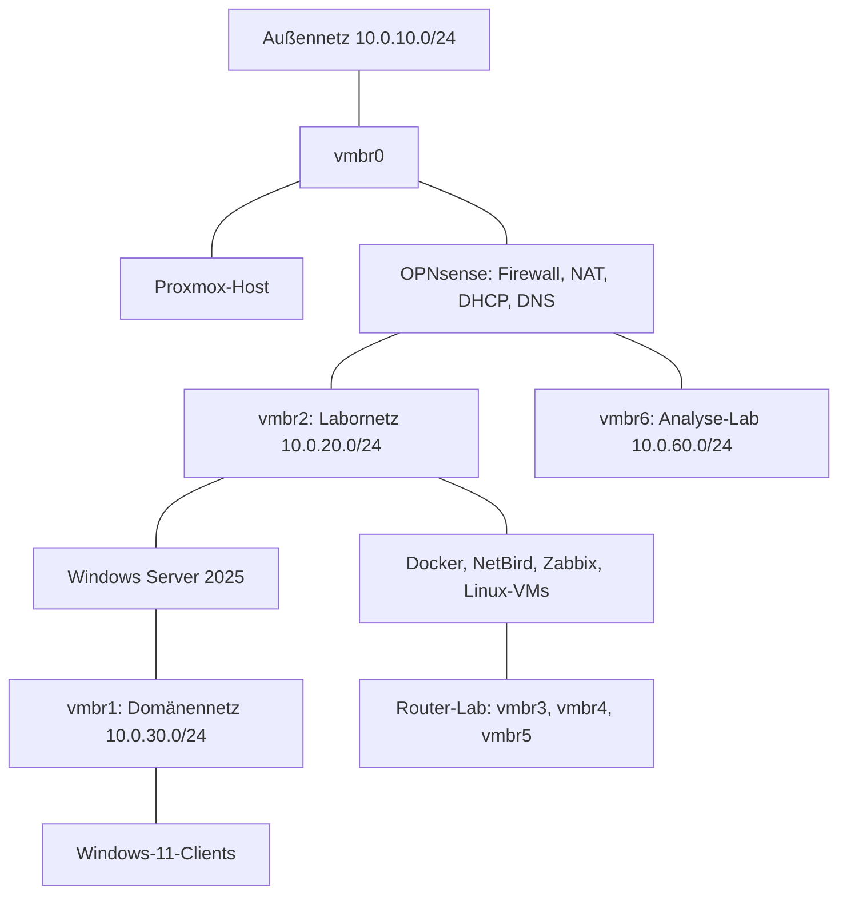

# Homelab mit Proxmox VE

Ein virtualisiertes Labor auf einem einzelnen Server: getrennte Netze hinter einer Firewall, Windows- und
Linux-Systeme, zentrale Verwaltung mit Ansible, Monitoring und Backups. Hier dokumentiere ich den Aufbau und
vor allem die **Probleme, die dabei aufgetreten sind**.

> **Entstehung:** Aufbau und Dokumentation sind mit Unterstützung eines KI-Assistenten (Claude) entstanden,
> während meiner Umschulung zum Fachinformatiker für Digitale Vernetzung.
>
> IP-Adressen, Benutzernamen und Domänennamen sind durch Beispielwerte ersetzt. Echte Passwörter und Tokens
> gehören nicht in dieses Repository.

## Netzplan

Die Bridges `vmbr1` bis `vmbr6` haben **keinen physischen Port**. So kann kein DHCP-Server aus dem Labor direkt
Adressen ins Außennetz verteilen.

## Eingesetzte Technik

| Bereich | Werkzeuge |
|---|---|
| Virtualisierung | Proxmox VE 9, KVM-VMs, LXC-Container, LVM-Thin, PCIe-Passthrough |
| Netzwerk | Linux-Bridges, OPNsense, NetBird (WireGuard), Routing-Labor |
| Betriebssysteme | Debian 13, Ubuntu, Windows Server 2025, Windows 11 |
| Windows-Dienste | Active Directory, DNS, DHCP, Sysprep-Vorlagen |
| Automatisierung | Ansible |
| Dienste | Docker, Portainer, MariaDB, apt-cacher-ng, BookStack |
| Monitoring | Zabbix 7.0, Prometheus, Grafana |
| Sicherheit, Analyse | fail2ban, Wireshark, ntopng |
| Sicherung | vzdump, systemd-Timer, rclone |

## Dokumentation

| Seite | Inhalt |
|---|---|
| [Probleme und Lösungen](docs/probleme-und-loesungen.md) | Fehlersuche aus dem Betrieb, **guter Einstieg** |
| [Grundaufbau](docs/01-grundaufbau.md) | Installation, Speicher, Bridges, Vorlagen |
| [Netzwerk und Zugriff](docs/02-netzwerk.md) | OPNsense, NetBird, fail2ban |
| [Ansible](docs/03-ansible.md) | Linux-Systeme zentral verwalten ([Dateien](ansible/)) |
| [Monitoring](docs/04-monitoring.md) | Zabbix, eigene Thin-Pool-Überwachung, Prometheus |
| [Backup](docs/05-backup.md) | Was gesichert wird und wie man es zurückholt |
| [Wireshark-Lab](docs/06-wireshark-lab.md) | Eigenes Netz zur Protokollanalyse |
| [Windows-Domäne](docs/07-windows-domaene.md) | Domänencontroller und Client-Vorlage |
| [GPU-Passthrough](docs/08-gpu-passthrough.md) | Grafikkarte an eine VM durchreichen |

## Hardware
Ein einzelner Rechner mit einer 1-TB-HDD, einer SSD und zwei weiteren Festplatten, dazu eine Nvidia Quadro
M5000 für das Passthrough. Die HDD wird schnell zum Engpass, deshalb liegen zeitkritische VMs auf anderen
Datenträgern.

## Offene Punkte
- SSH-Anmeldung überall auf Schlüssel beschränken
- Wiederherstellung der Backups regelmäßig üben
- Zabbix-Meldungen für absichtlich ausgeschaltete VMs abstellen
