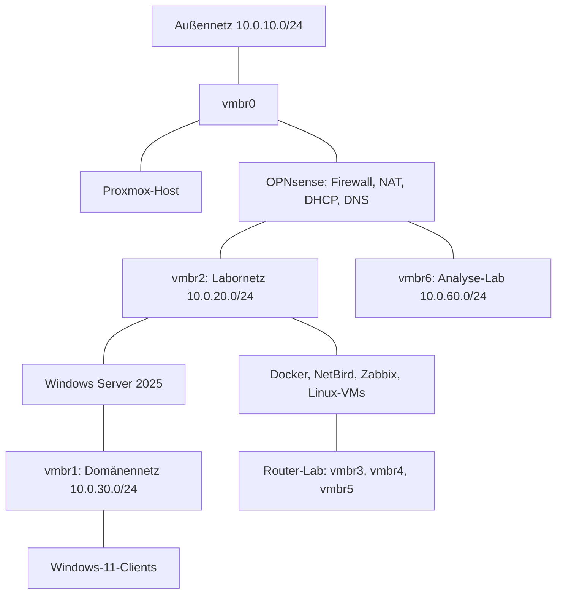
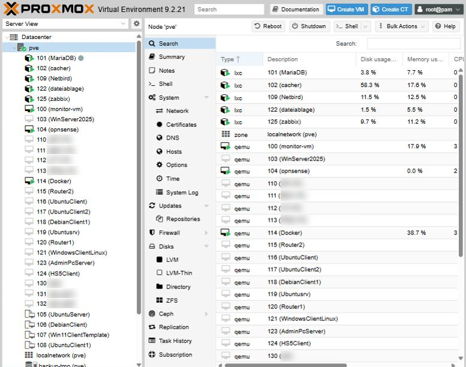

# Homelab mit Proxmox

Hier dokumentiere ich mein Labor auf einem Proxmox-Server, den ich während der Umschulung aufgebaut habe.
Angefangen hat es mit ein paar VMs für den Unterricht, inzwischen laufen darauf eine Firewall, eine Windows-Domäne,
mehrere Linux-Server und Container.

Eingerichtet habe ich das meiste über die grafischen Oberflächen (Proxmox, OPNsense, Server-Manager). In der Doku
stehen trotzdem oft Befehle, weil man sie besser festhalten und wiederholen kann. Wo es passt, steht der Weg über
die Oberfläche dabei.

Am meisten gelernt habe ich bei den Sachen, die nicht auf Anhieb funktioniert haben. Die stehen gesammelt unter
[Probleme und Lösungen](docs/probleme-und-loesungen.md).

Beim Aufbau und beim Schreiben der Doku hat mir ein KI-Assistent (Claude) geholfen. IP-Adressen, Namen und
Domänen habe ich durch Beispielwerte ersetzt.

## Netzplan

Nur `vmbr0` hängt am echten Netzwerkanschluss. Die anderen Bridges haben keinen, damit mein DHCP nicht aus
Versehen Adressen ins fremde Netz verteilt.

## Was drauf läuft

- Proxmox VE 9 mit VMs und LXC-Containern, drei Speicherpools (LVM-Thin), eine durchgereichte Grafikkarte
- OPNsense als Firewall vor dem Labornetz, NetBird als VPN für den Zugriff von unterwegs
- Windows Server 2025 mit Active Directory, DNS, DHCP und Gruppenrichtlinien, dazu Windows-11-Clients
- Vorlagen (Templates) für Ubuntu Server, Ubuntu- und Debian-Desktop und Windows 11, aus denen ich neue VMs klone
- Ubuntu- und Debian-VMs, zwei davon als Router
- Ansible, um die Linux-Maschinen gemeinsam zu verwalten
- Docker mit Portainer, BookStack (mein Wiki) und Prometheus/Grafana
- Zabbix zur Überwachung, MariaDB als Übungsdatenbank
- Backups mit vzdump und rclone

## Doku

Proxmox und Netz:
- [Grundaufbau](docs/01-grundaufbau.md): Installation, Speicher, Bridges, Vorlagen
- [Netzwerk und Zugriff](docs/02-netzwerk.md): OPNsense, NetBird, fail2ban
- [Ansible](docs/03-ansible.md) mit den [Dateien](ansible/)
- [Monitoring](docs/04-monitoring.md): Zabbix, eigene Überwachung der Speicherpools, Prometheus
- [Backup](docs/05-backup.md)
- [Docker, Portainer und BookStack](docs/17-docker-bookstack.md): mein Wiki und wie es gesichert wird
- [Wireshark-Lab](docs/06-wireshark-lab.md)
- [GPU-Passthrough](docs/08-gpu-passthrough.md)

Windows (Übungsprojekt aus der Umschulung, eine kleine Firma mit vier Abteilungen):
- [Domänencontroller und Client-Vorlage](docs/07-windows-domaene.md)
- [Active Directory](docs/09-active-directory.md): Benutzer, Gruppen, NTFS-Rechte, Laufwerke
- [Gruppenrichtlinien und Softwareverteilung](docs/10-gpo-softwareverteilung.md)
- [DHCP, NAT, NAS, iSCSI und Serversicherung](docs/11-windows-dienste-speicher.md)
- [Windows ohne Domäne](docs/12-windows-arbeitsgruppe.md)

Linux und Datenbanken:
- [Routing mit zwei Linux-Routern](docs/13-linux-routing.md)
- [Debian absichern](docs/14-linux-absichern.md)
- [MariaDB mit SSH-Tunnel](docs/15-mariadb.md)
- Mein größeres Datenbankprojekt ist die [Pokémon-Sammlung](https://github.com/uncrebal/pokemon-sammlung) mit PostgreSQL.

Und wie ich mit KI arbeite:
- [Arbeiten mit Claude](docs/16-arbeiten-mit-claude.md): was eingerichtet ist und wo ich Grenzen ziehe

## Hardware
Ein Rechner mit einer 1-TB-HDD, einer SSD, zwei älteren Festplatten und einer Nvidia Quadro M5000. Die HDD ist
langsam, deshalb liegen Windows und die wichtigen VMs auf der SSD.

## Was noch fehlt
- Eine komplette VM aus dem Backup zurückspielen und das dokumentieren
- SSH überall nur noch mit Schlüssel
- Zabbix soll nicht mehr bei VMs meckern, die absichtlich aus sind
