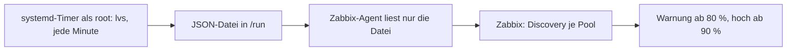

# Monitoring

## Zabbix 7.0 LTS
Läuft in einem unprivilegierten LXC-Container mit PostgreSQL, Apache und PHP.

**Warum so?** Ein Container braucht weniger Ressourcen als eine VM. Debian 13 bringt PostgreSQL 17 mit. Für den
Debian-13-Container war die Proxmox-Funktion *nesting* nötig (wirkt erst nach einem Neustart).

### Proxmox ohne Agent überwachen
Das Template *Proxmox VE by HTTP* liest über die API. Dafür gibt es einen eigenen Benutzer, der **nur lesen** darf:

```bash
pveum user add zabbix@pve
pveum acl modify / --users zabbix@pve --roles PVEAuditor
pveum user token add zabbix@pve monitoring --privsep 0
```

Das Token-Geheimnis wird nur einmal angezeigt. In Zabbix wird es als Makro vom Typ *Secret text* gespeichert.

## Eigene Überwachung der Thin-Pools
**Problem:** Thin-Pools sind überbucht. Erreichen Daten **oder Metadaten** 100 %, können VMs nicht mehr schreiben.
Das mitgelieferte Template warnte erst ab 90 % und erfasste die Metadaten nicht.



- `lvs` braucht root. So läuft nur der Timer als root, für diese Abfrage braucht der Agent weder root noch sudo.
- Geschrieben wird erst in eine temporäre Datei, dann wird umbenannt. So liest der Agent nie eine halbe Datei.
- Eine zusätzliche Meldung kommt, wenn 5 Minuten lang keine Daten eintreffen.

Kern des systemd-Service:

```ini
[Service]
Type=oneshot
RuntimeDirectory=zabbix-thinpool
RuntimeDirectoryMode=0755
RuntimeDirectoryPreserve=yes
ExecStart=/bin/sh -c '/usr/sbin/lvs --reportformat json -o vg_name,lv_name,lv_size,data_percent,metadata_percent --select segtype=thin-pool > /run/zabbix-thinpool/lvs.json.tmp && chmod 644 /run/zabbix-thinpool/lvs.json.tmp && mv /run/zabbix-thinpool/lvs.json.tmp /run/zabbix-thinpool/lvs.json'
```

## Prometheus und Grafana
Ein zweiter Weg ist ein [Compose-Stack](../compose/monitoring.yml) mit Prometheus, Grafana, Node-Exporter und
PVE-Exporter (eigener Benutzer mit Nur-Lese-Rolle). Node- und SMART-Exporter laufen zusätzlich auf dem Host.
Unter `/targets` sollten alle Ziele *UP* sein. Das Standardpasswort von Grafana beim ersten Anmelden ändern.
