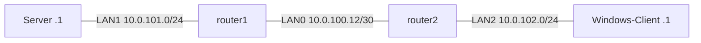

# Linux-Routing mit statischen Routen

Zwei Ubuntu-Server arbeiten als Router und verbinden drei Netze. Ein Windows-Client soll einen Linux-Server am
anderen Ende erreichen. Die Adressen sind Beispielwerte.

## Netzplan


**Schema:** Server bekommen die erste Adresse im Netz, Router die letzte. Für die Verbindung zwischen den Routern
reicht ein `/30`: zwei nutzbare Adressen, dazu Netz- und Broadcastadresse.

| Gerät | Netz | Adresse | Gateway bzw. Route |
|---|---|---|---|
| Server | LAN1 | `10.0.101.1/24` | Standard über `.254` |
| router1 | LAN1 | `10.0.101.254/24` | |
| router1 | LAN0 | `10.0.100.13/30` | `10.0.102.0/24` über `10.0.100.14` |
| router2 | LAN0 | `10.0.100.14/30` | `10.0.101.0/24` über `10.0.100.13` |
| router2 | LAN2 | `10.0.102.254/24` | |
| Windows-Client | LAN2 | `10.0.102.1/24` | Standard über `.254` |

Auf Proxmox sind die drei Netze eigene Bridges ohne physischen Port, siehe [Grundaufbau](01-grundaufbau.md).

## Netplan (router1)
Die Namen der Schnittstellen vorher mit `ip -br link` prüfen.

```yaml
network:
  version: 2
  ethernets:
    ens19:                       # LAN1
      addresses: [10.0.101.254/24]
    ens20:                       # LAN0
      addresses: [10.0.100.13/30]
      routes:
        - to: 10.0.102.0/24
          via: 10.0.100.14
```

router2 entsprechend gespiegelt.

```bash
sudo chmod 600 /etc/netplan/*.yaml
sudo netplan try      # übernimmt probeweise, ohne Bestätigung wird zurückgestellt
```

## Weiterleitung einschalten (beide Router)
```bash
echo "net.ipv4.ip_forward=1" | sudo tee /etc/sysctl.d/99-router.conf
sudo sysctl --system
sysctl net.ipv4.ip_forward     # muss 1 ergeben
```

## Prüfen
```bash
ip route                 # Routingtabelle
ping -c 3 10.0.102.1
tracepath 10.0.102.1     # zeigt die Sprünge
```

Auf dem Windows-Client eingehende ICMPv4-Echoanfragen in der Firewall erlauben.

## Typische Fehler
- `ip_forward` steht auf 0
- Route nur in eine Richtung: Der Ping kommt an, die Antwort findet nicht zurück
- Beide Karten eines Routers hängen im selben Netz
- Tabulatoren statt Leerzeichen in der YAML-Datei
- UFW auf dem Router blockiert die Weiterleitung (`ufw route allow ...`)

## Subnetting-Übung
**Aufgabe:** Zwei Netze für je 6 Adressen, getrennt durch einen Router.

6 Hosts + Netz- und Broadcastadresse = 8 = 2³, also 3 Hostbits und damit `/29` (`255.255.255.248`).

| Netz | Netz-ID | Server (erste) | Router (letzte) | Broadcast |
|---|---|---|---|---|
| A | `10.0.110.0/29` | `.1` | `.6` | `.7` |
| B | `10.0.110.8/29` | `.9` | `.14` | `.15` |
