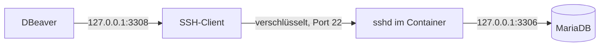

# MariaDB-Server mit SSH-Tunnel und Rechtekonzept

MariaDB in einem LXC-Container, Zugriff vom Arbeitsrechner mit DBeaver. Als Übungsdatenbank dient **sakila**.
Ein größeres eigenes Datenbankprojekt ist die [Pokémon-Sammlung](https://github.com/uncrebal/pokemon-sammlung)
mit PostgreSQL.

## Einrichtung
```bash
apt install -y mariadb-server
mariadb-secure-installation     # root absichern, Testdatenbank und anonyme Konten entfernen
```

Vor größeren Änderungen wurde ein Proxmox-Snapshot angelegt, um jederzeit zurückzukönnen.

## Zugriff über einen SSH-Tunnel
Statt Port 3306 im Netz zu öffnen, läuft die Verbindung verschlüsselt über SSH:



```powershell
ssh -L 3308:127.0.0.1:3306 admin@db01
```

In DBeaver: Host `127.0.0.1`, Port `3308`. Der Tunnel muss während der ganzen Sitzung offen sein.

**Wichtig verstanden:** MariaDB sieht Verbindungen durch den Tunnel als Anmeldung von `localhost`. Deshalb braucht
man ein Konto `'name'@'localhost'`, ein Konto mit Host `%` greift hier nicht.

## Rechte nach dem Minimalprinzip

```sql
-- Arbeitskonto: alles, aber nur in sakila
CREATE USER 'app_sakila'@'localhost' IDENTIFIED BY '...';
GRANT ALL PRIVILEGES ON sakila.* TO 'app_sakila'@'localhost';

-- weitere Person: nur lesen
CREATE USER 'leser'@'localhost' IDENTIFIED BY '...';
GRANT SELECT ON sakila.* TO 'leser'@'localhost';

SHOW GRANTS FOR 'leser'@'localhost';
```

Gegenprobe: `SELECT` in sakila klappt. `SELECT` auf `mysql.user` und `UPDATE` als Leser scheitern mit Fehler 1142,
`CREATE DATABASE` scheitert mit Fehler 1044.

Danach wurde das alte Konto entfernt, das sich aus dem ganzen Netzbereich anmelden durfte (`DROP USER`).
Das lokale Administrationskonto mit `unix_socket` muss bleiben, sonst kommt man selbst nicht mehr in die Datenbank.

| Ebene | Bedeutung |
|---|---|
| `*.*` | ganzer Server, auch die Kontentabelle |
| `sakila.*` | alle Tabellen einer Datenbank |
| `sakila.film` | eine einzelne Tabelle |

## Fehlersuche
| Meldung | Ursache |
|---|---|
| *Connection refused* in DBeaver | Tunnel nicht offen |
| *Address already in use* | lokaler Port belegt, anderen nehmen |
| 1698 | Anmeldung an ein `localhost`-Konto mit `unix_socket` |
| 1045 | falsches Passwort, mit `ALTER USER ... IDENTIFIED BY` neu setzen |
| DBeaver zeigt nach `exit` weiter Daten | ein zweiter Tunnel lief noch: `Get-NetTCPConnection -LocalPort 3308 -State Listen` |

## Stand
Tunnel, eingeschränkte Konten und das Entfernen des Netzkontos sind umgesetzt. **Noch offen:** MariaDB nur noch auf
`127.0.0.1` lauschen lassen (`bind-address`) und von außen prüfen, dass Port 3306 zu ist. Bis dahin ist der Port
im Labornetz noch erreichbar, auch wenn es kein Konto mehr gibt, das sich von dort anmelden darf.
